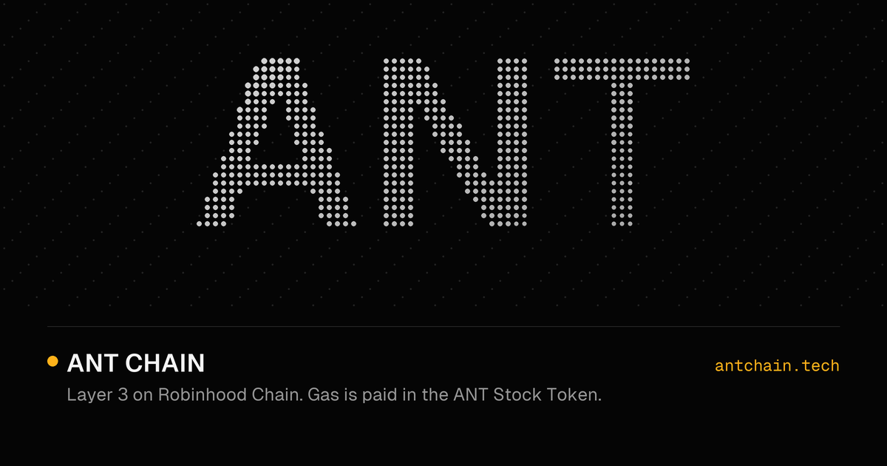
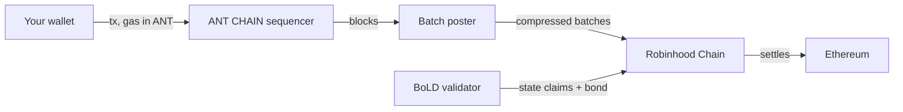

<p align="center">
  <a href="https://antchain.tech"></a>
</p>

<h1 align="center">ANT CHAIN</h1>

<p align="center">
  <a href="https://github.com/AntChainL3/ant-chain/actions/workflows/ci.yml"></a>
  <a href="LICENSE"></a>
  <a href="https://sonarcloud.io/summary/new_code?id=AntChainL3_ant-chain"></a>
  <a href="https://sonarcloud.io/summary/new_code?id=AntChainL3_ant-chain"></a>
  <a href="https://sonarcloud.io/summary/new_code?id=AntChainL3_ant-chain"></a>
  <a href="https://sonarcloud.io/summary/new_code?id=AntChainL3_ant-chain"></a>
</p>

<p align="center">
  An independent Arbitrum Layer 3 on Robinhood Chain where every fee is paid in the <b>ANT Stock Token</b>.<br>
  <a href="https://antchain.tech">Website</a> ·
  <a href="https://antchain.tech/bridge/">Bridge</a> ·
  <a href="https://antchain.tech/swap/">Swap</a> ·
  <a href="https://antchain.tech/launch/">Launchpad</a> ·
  <a href="https://antchain.tech/explorer/">Explorer</a> ·
  <a href="https://antchain.tech/docs/">Docs</a> ·
  <a href="https://x.com/antchainl3">X</a>
</p>

---

## What is ANT CHAIN?

ANT CHAIN is a blockchain built with Arbitrum Nitro. It runs as a **Layer 3**: it posts its data to **Robinhood Chain** (a Layer 2), which in turn settles to **Ethereum**.

The one thing that makes it different is its gas token. On most chains you pay fees in ETH. On ANT CHAIN you pay them in **ANT**, the Robinhood Stock Token that tracks the price of Anthropic, PBC shares. Your wallet shows ANT as your balance, and every transaction takes a small amount of it as the fee: about a fortieth of a cent for a transfer at today's prices.

Everything else works like any EVM chain: MetaMask, Rabby, Foundry, Hardhat, viem and ethers all work unchanged.

> ANT CHAIN is independent. It is not made, endorsed or sponsored by Anthropic, PBC, Robinhood Markets, Inc. or Offchain Labs. "ANT" is the ticker of the token used as gas.

## Status

| Part | Status |
|---|---|
| **Mainnet** (chain 26800) | **Live** on Robinhood Chain, gas paid in ANT. Guide: [docs/mainnet-guide.md](docs/mainnet-guide.md) |
| **Testnet** (chain 26801) | **Live**: free test tokens, switch to Testnet on [antchain.tech/bridge](https://antchain.tech/bridge/) |
| Bridge (deposit, withdraw, claim) | Live on mainnet (withdrawals ~7 days) and testnet (~1 hour) |
| Exchange (Uniswap V2) | Live on mainnet; tANT/tUSD pool on testnet |
| Explorer (blocks, transactions, addresses) | Live for testnet and mainnet |
| Test kit faucet | Live on testnet |
| $ANTC, the ANT CHAIN token | **Live** on [Pons](https://ponsfamily.com/launchpad/0x1A9ca5A347c4aeAb4870668E76506E45C23D6281), Robinhood Chain. Contract `0x1A9ca5A347c4aeAb4870668E76506E45C23D6281`. See [Token](#the-antc-token). |
| Launchpad (tokens that trade in $ANTC) | **Live** at [antchain.tech/launch](https://antchain.tech/launch/), contract `0x2BECe5405eE63844e6d14dF44c3aDE22AD3533dA`. See [docs/launchpad.md](docs/launchpad.md) |
| $ANTC staking for gas credits | **Live** at [antchain.tech/stake](https://antchain.tech/stake/), contract `0xfd0d05df472a932e6bc64ca34744c77fd3c7b1ac` on Robinhood Chain. |

Full roadmap, kept up to date: [docs/roadmap.md](docs/roadmap.md) · [antchain.tech/roadmap](https://antchain.tech/roadmap/)

## Meet tANT, the testnet gas token

On testnet, real ANT is replaced by **tANT** ("Test ANT"): a free token with **no value** that behaves exactly like ANT does on mainnet. You bridge it in, it becomes your gas, and you spend it on fees, swaps and contracts.

- **What it is:** an ERC-20 on Robinhood Chain Testnet, 18 decimals, at [`0xbf10d827020a5f4260e27a005ae0034d97514b17`](docs/contracts.md). Source: [`chain/contracts/TestANT.sol`](chain/contracts/TestANT.sol).
- **How to get it:** press **Get test kit** on the [bridge page](https://antchain.tech/bridge/). It sends you testnet ETH for gas plus 100 tANT, once a day per wallet. You can also call `drip()` on the contract yourself for 100 tANT a day.
- **What it is not:** it is not ANT, it cannot be sold, and it has no price. The dollar figures you see on testnet use the real ANT price only to show what fees *would* cost.

Full details: [docs/tant.md](docs/tant.md)

## Try the testnet in five minutes

1. **Connect** a wallet at [antchain.tech/bridge](https://antchain.tech/bridge/) (MetaMask, Rabby, Coinbase Wallet, or any mobile wallet through WalletConnect).
2. **Get a test kit**: testnet ETH and 100 tANT land in your wallet on Robinhood Chain Testnet.
3. **Deposit** some tANT. It arrives on ANT CHAIN Testnet as gas within about a minute.
4. **Swap** tANT for tUSD, or add liquidity, at [antchain.tech/swap](https://antchain.tech/swap/).
5. **Withdraw** back. A countdown shows when your claim opens (about an hour on testnet), then press **Claim**.

Step by step, with what to expect at each step and fixes for common problems: [docs/testnet-guide.md](docs/testnet-guide.md)

Using real ANT on mainnet: [docs/mainnet-guide.md](docs/mainnet-guide.md)

## Network details

| | Testnet | Mainnet (live) |
|---|---|---|
| Network name | ANT CHAIN Testnet | ANT CHAIN |
| Chain ID | `26801` (`0x68b1`) | `26800` (`0x68b0`) |
| RPC | `https://rpc.testnet.antchain.tech` | `https://rpc.antchain.tech` |
| Gas token | tANT (test, no value) | ANT Stock Token |
| Parent chain | Robinhood Chain Testnet (46630) | Robinhood Chain (4663) |
| Settles to | Ethereum (through Robinhood Chain) | Ethereum (through Robinhood Chain) |
| Explorer | [antchain.tech/explorer/testnet](https://antchain.tech/explorer/testnet/) | [antchain.tech/explorer](https://antchain.tech/explorer/) |
| Withdrawal wait | about 1 hour | about 7 days |

All contract addresses: [docs/contracts.md](docs/contracts.md)

## How it works



1. **You sign** a transaction and pay gas in ANT.
2. **The sequencer** orders it into a block, usually within a second.
3. **The batch poster** compresses blocks and posts them to Robinhood Chain. It pays ETH there and is repaid in ANT at a rate from Chainlink ETH/USD and the ANT price ([`AntFeeTokenPricer.sol`](chain/contracts/AntFeeTokenPricer.sol)).
4. **A bonded validator** posts the resulting state. Anyone can challenge a wrong claim during the challenge window (BoLD).
5. **Ethereum** has the final say, through Robinhood Chain.

More: [docs/how-it-works.md](docs/how-it-works.md)

## The $ANTC token

**$ANTC** is the ANT CHAIN token. It launched on [Pons](https://ponsfamily.com/launchpad/0x1A9ca5A347c4aeAb4870668E76506E45C23D6281), the token launchpad on Robinhood Chain.

| | |
|---|---|
| Contract (Robinhood Chain, 4663) | `0x1A9ca5A347c4aeAb4870668E76506E45C23D6281` |
| Name / ticker | ANT Chain / ANTC |
| Supply | 1,000,000,000 |
| Decimals | 18 |

Only this address is ours. It has three jobs on the chain:

- bidding for the **express lane** (priority ordering of transactions, Arbitrum Timeboost),
- a **daily gas allowance** for people who stake it,
- a **0.01% bridge and swap fee** used to buy $ANTC back and burn it.

The first of these to ship is **staking for gas credits**: stake $ANTC on Robinhood Chain and earn credits (token-days) that pay for gas on ANT CHAIN once credit spending opens (coming soon). Unstaking is never blocked, nobody can move staked tokens, and credits are not a token: they cannot be sold and pay no yield. Contract: [`chain/contracts/ANTcStaking.sol`](chain/contracts/ANTcStaking.sol), 23 tests including fuzzing. Step-by-step guide: [docs/staking-guide.md](docs/staking-guide.md).

Staking opens first; express-lane bids and the buyback come with ANT CHAIN mainnet. Gas itself stays ANT. $ANTC is not connected to Anthropic, PBC and gives no rights in Anthropic or in ANT. Nothing in this repository is an offer or investment advice.

## Know the token you pay with

ANT CHAIN does not issue ANT and cannot change it. ANT is issued by Robinhood Assets (Jersey) Limited as a tokenized debt security that tracks the share price; holders get price exposure, not shares or shareholder rights. It is not available to US persons and is restricted in several other places. Its issuer can **pause** transfers, **block** addresses (including our bridge), **burn** balances and **upgrade** the token contract. These powers apply to every chain that uses a Robinhood stock token as gas.

## Repository layout

```text
chain/        contracts, deployment scripts, node config generator, keeper, faucet, monitor
  contracts/  AntFeeTokenPricer, TestANT (tANT), TestUSD (tUSD), WrappedANT
  scripts/    numbered deploy steps (00 to 05), bridge helpers, faucet, smoke tests
site/         antchain.tech: home, bridge, swap, docs, explorer (static, served by Caddy)
walletkit/    source of the wallet modal (RainbowKit + wagmi); its build output is not committed
docs/         this documentation
DESIGN.md     design system of the website
```

### Run the website locally

```bash
cd walletkit && npm install && npm run build && cd ..   # builds site/js/walletkit and site/walletkit.css
cd site
python -m http.server 8765                              # then open http://127.0.0.1:8765
```

The wallet bundle is build output of third-party libraries, so it is not committed: build it once before serving or deploying the site. The pages read live data straight from the public RPCs, so nothing else needs to run.

### Chain scripts

See [chain/README.md](chain/README.md). Deploy scripts need operator keys in `.env` / `.env.mainnet`, which are never committed.

## Trust model

Today one operator runs the sequencer, the batch poster and the validator. That is normal for a new Arbitrum chain and it is the main trust assumption to know about: the sequencer can delay or reorder transactions, but it cannot forge state, because the validator's claims are bonded and open to challenge, and withdrawals wait for the challenge window. Chain ownership currently sits with the deployer key.

## Security

Found a problem? Please do not open a public issue for anything that could put funds at risk. See [SECURITY.md](SECURITY.md) for how to report it privately.

## Transparency

Every contract, every wallet the team operates and what it can do, where fees go, and what is not in place yet: [TRANSPARENCY.md](TRANSPARENCY.md). Anyone can check that the code running on chain is the code in this repository with `node chain/scripts/verify-bytecode.js` (also run by CI on every push).

## License

The code in this repository is released under the [MIT License](LICENSE), with these exceptions:

- [`chain/contracts/WrappedANT.sol`](chain/contracts/WrappedANT.sol) is a port of WETH9 and keeps its **GPL-3.0-or-later** license, as stated in the file.
- The wallet bundle (`site/js/walletkit/`, built locally and not committed) comes from RainbowKit, wagmi, viem, React and TanStack Query, each under its own license (MIT).
- The exchange contracts are the official Uniswap V2 bytecode, fetched from npm at deploy time and not stored here; they remain under Uniswap's licenses.
- The chain itself runs the official Arbitrum Nitro node and contracts from Offchain Labs, under their licenses.

What is **not** in this repository: operator private keys, the generated node configuration that contains them, and hosting settings. Everything else needed to read, check and rebuild the contracts, scripts and website is here.

## Disclaimer

ANT CHAIN is independent and not affiliated with Anthropic, PBC, Robinhood Markets, Inc., Offchain Labs or Uniswap Labs. Names are used only to describe the assets and technology involved. Nothing here is investment advice or an offer of securities. Tokenized stocks carry market, issuer and regulatory risk and are not available everywhere. Testnet tokens (tANT, tUSD, testnet ETH) have no value. Mainnet is in beta.
